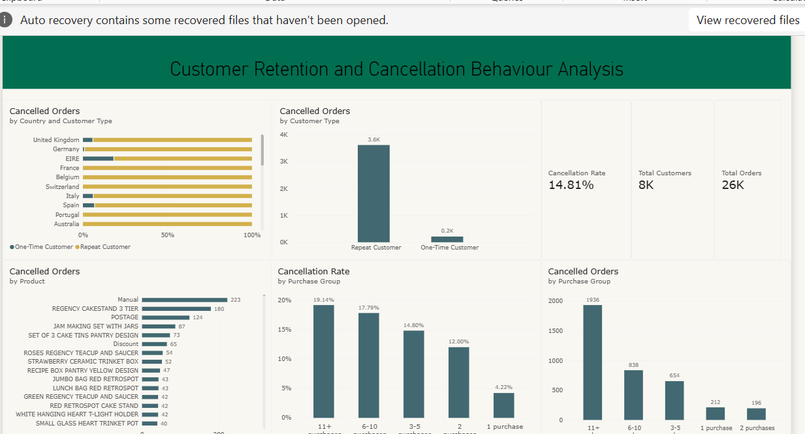
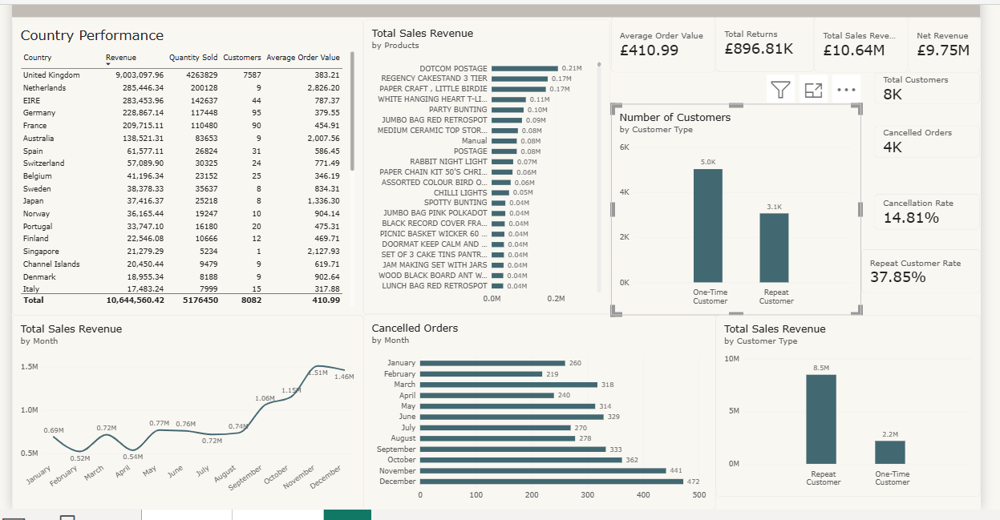

# Online Retail Customer Behaviour Cancellation Study
  
   

##  Executive Summary
This data analytics project investigates customer purchasing behavior, revenue structures, and order cancellation dynamics for a global online retail enterprise. 

The core objective was to solve a specific operational puzzle: **Are repeat customers canceling more orders simply due to higher transaction volumes, or does their baseline cancellation probability scale upward as purchase frequency increases?**

###  Core Discoveries
* Repeat buyers make up only **38% of the customer base** but generate **79.5% of total sales revenue** (£8.5M vs. £2.2M).
* Order cancellation volumes are disproportionately concentrated among high-frequency customers.
* Cancellation rates scale exponentially based on user loyalty, climbing steadily from **4.22%** for single-purchase users to **19.14%** for power users (11+ purchases).

---

##  Data Preparation  (Python & Pandas)
Before visualization, the raw transactional dataset containing over **500,000 records** was programmatically cleaned using Python to ensure architectural integrity:
* Cleaned missing product records by programmatically cross-referencing and matching missing text fields using historical `StockCode` mappings.
* Structuralized inconsistent, trailing, and mistyped product description values.
* Isolated canceled transactions by parsing invoice alphanumeric conventions to separate clean revenue rows from active reversals.
* Computed custom attributes and specialized cohort groupings to track user frequency buckets.

---

##  Analytical Findings

### 1. One-Time vs. Repeat 
The exploratory analysis identified **8,082 unique customer profiles** across the transactional lifecycle. While acquiring new traffic keeps total customer counts high, active repeat behaviors completely drive financial viability:

* One-Time Buyers are 62% of total customer base with £2.2 Million total revenue contribution.
* Repeat Buyers are 38% of total customer base with £8.5 Million total revenue contribution.

### 2. Cancellation Volatility
While repeat buyers keep the business alive, they also account for the highest overhead leaks, driving **3,600 individual cancellations** compared to only **200 cancellations** from one-time shoppers. 

To determine if this was a natural byproduct of volume or a systemic breakdown, transactions were segmented by frequency:

| Purchase Frequency | Type of Customer | Cancellation Rate |
| :--- | :--- | :--- |
| **1 Purchase** | New customers | **4.22%** |
| **2 Purchases** | Returning customers | **12.00%** |
| **3–5 Purchases** | Core Customers | **14.80%** |
| **6–10 Purchases** | High-Value Advocates | **17.79%** |
| **11+ Purchases** | Enterprise customer | **19.14%** |

The definitive upward trend proves that cancellation risk scales with loyalty. This suggests that backend platform friction, delivery lag, or stock exhaustion issues disproportionately penalize the company’s most valuable accounts.

### 3. Product Analysis
* Cancellation instances heavily cluster around specific high-volume standard units, including *Manual, Regency Cakestand 3 Tier, Postage, Jam Making Set With Jars*, and *Set of 3 Cake Tins Pantry Design*. 
* Cancelled invoices tracked a dramatic upward trajectory toward the close of the calendar year, escalating from a baseline of **260 instances in January** to a peak of **472 instances in December** (coinciding with holiday logistics constraints).

---

##  Strategic Business Recommendations

Based on the empirical evidence, the business should deploy the following mitigation strategies:
1. Implement priority logistics processing or dedicated inventory allocations for the `11+ Purchase` customer tier to drive their 19.14% cancellation rate back down to industry baselines.
2. Investigate inventory, description discrepancies, or quality issues for the top 5 high-volume canceled products (e.g., *Regency Cakestand*) to check for listing errors or systematic return reasons.
3. Scale supply chain capacity, server performance checking, and safety stock thresholds ahead of the Q4 holiday surge (November–December) to mitigate transaction drops during peak periods.

---

##  Project Structure & Deliverables
* **[Python Data Cleaning Script](https://github.com/Ginika-Paul/Online-Retail-Customer-Behavior-Cancellation-Analysis/tree/main/Python):** Comprehensive source code for structural cleaning, data imputation, and initial statistical validation via Pandas.
* **[Power BI Dashboard File]([./Ecom_Analysis_Dashboard.pbix](https://github.com/Ginika-Paul/Online-Retail-Customer-Behavior-Cancellation-Analysis/tree/main/power%20bi)):** Interactive `.pbix` framework featuring transactional tracking, dynamic segmentation panels, and automated KPI scorecards.
* **[Dasboard Screenshots](https://github.com/Ginika-Paul/Online-Retail-Customer-Behavior-Cancellation-Analysis/tree/main/pic):**
